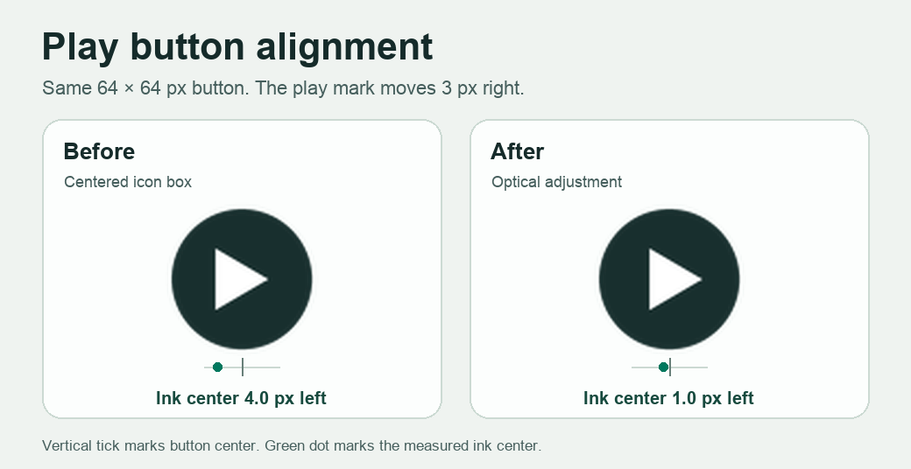

# Optical Align

Measure the visible weight of an icon or glyph when its layout box is already aligned. Run the analyzer on a PNG to get foreground bounds, a weighted centroid, guides, and blur views.

## Play button before and after



The button is a circle with a 64 × 64 px reference box. In the first render, the play mark's bounding box is centered and its weight sits about 4 px to the left of center. Moving the triangle 3 px right puts the measured center about 1 px to the left. The diagram enlarges both controls by the same factor. The source pixel offsets are specific to this mark and size.

## Install the skill

Copy this entire `optical-align` directory into your agent's skills directory, such as `~/.codex/skills/` or `~/.claude/skills/`, and start a new session. Ask your agent to use `optical-align` on a component and include a screenshot or the live target. The directory contains everything for the skill except the Python runtime and Pillow. [Agent installation commands](https://github.com/suicuLsi/agent-skills#install)

## Run the example

The analyzer runs offline with Python and Pillow. From the `optical-align` directory on macOS or Linux, use an existing Python environment with Pillow or create one. [Pillow installation](https://pillow.readthedocs.io/en/stable/installation/basic-installation.html)

```sh
python3 -m venv "$HOME/.venvs/optical-align"
OPTICAL_PYTHON="$HOME/.venvs/optical-align/bin/python"
"$OPTICAL_PYTHON" -m pip install Pillow
```

The sample PNGs contain the transparent foreground so the analyzer can use alpha as the coverage mask. Each source image has the same reference rectangle. Choose new output directories for each run.

```sh
"$OPTICAL_PYTHON" scripts/analyze_optical.py assets/play-before.png \
  --pixels-per-unit 1 --unit image-px --container 24 24 88 88 --out play-before-report
"$OPTICAL_PYTHON" scripts/analyze_optical.py assets/play-after.png \
  --pixels-per-unit 1 --unit image-px --container 24 24 88 88 --out play-after-report
```

Open `comparison.png` for the guides and `measurements.json` for the numbers. In `centroid_minus_reference_center`, the first number should be close to `-3.96` before and `-0.96` after. Both reports should show `[24, 24, 88, 88]` as the reference rectangle.

For a real control, pass a measured screenshot scale and isolate the mark by using a transparent export, a matching grayscale coverage mask, or a uniform background. See the [skill instructions](SKILL.md) for input choices and interpretation.

## Tests

```sh
"$OPTICAL_PYTHON" -m unittest discover -s tests -v
```
